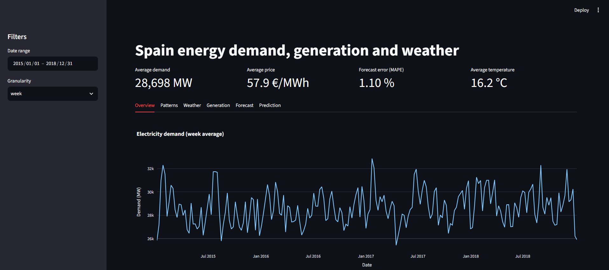
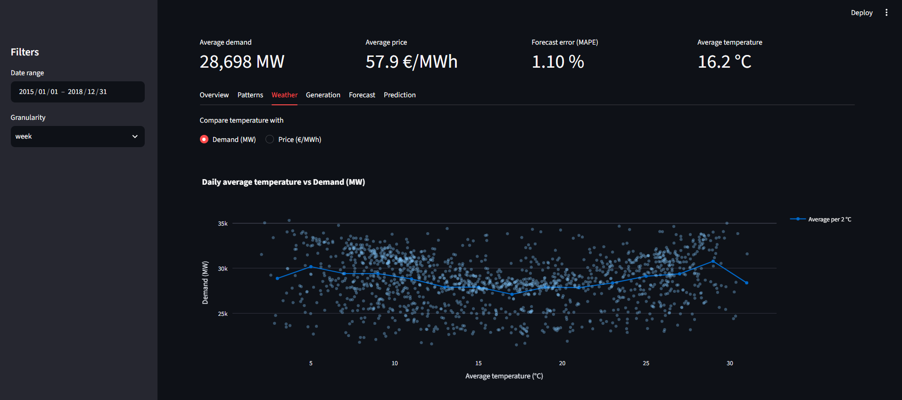
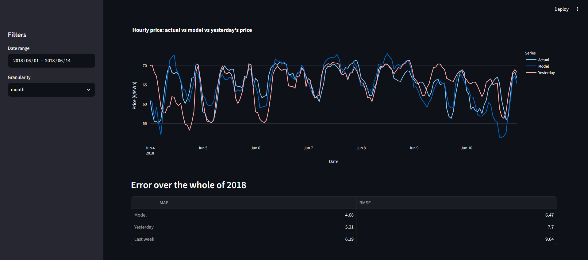

# Spain Energy Dashboard

An interactive dashboard to explore Spain's hourly electricity
demand, generation, prices and weather between 2015 and 2018, with a
machine learning model that predicts the next day's electricity
price. Built with Python, pandas, Plotly and Streamlit.

## What it does

- Filters the whole dashboard by date range and by granularity
  (hour, day, week or month), always in Madrid local time.
- Shows four KPIs for the selected period: average demand, average
  price, forecast error and average temperature.
- Has six tabs: demand overview, typical profiles by hour and
  weekday, temperature vs demand or price, generation mix, quality of
  the official demand forecast, and the price prediction model.
- Includes a model that predicts the hourly price the day before,
  evaluated on a full year it has never seen and compared with simple
  references.

## Main findings

- Demand has a valley at 4am and two peaks, at 1pm and 9pm, and
  weekends are about 10% lower than weekdays. The price follows the
  same pattern, and gas generation falls at the weekend.
- Demand has a U shape against temperature, with a minimum of about
  27,100 MW around 17 degrees, but temperature alone explains less
  than 10% of the daily variation.
- The official demand forecast is off by about 1.1% on average
  (MAPE 1.10%) and has no relevant bias.
- The price model beats the best simple reference, repeating the
  price of the day before, on the 2018 test year:

| Prediction | MAE (€/MWh) | RMSE (€/MWh) |
| --- | --- | --- |
| Model (gradient boosting) | 4.68 | 6.47 |
| Same hour yesterday | 5.21 | 7.70 |
| Same hour last week | 6.39 | 9.64 |

  The mean price in 2018 is 63.44 €/MWh, so the model is about 10%
  better in MAE and 16% in RMSE than yesterday's price. It is a
  modest improvement, measured on a single test year.

## Setup

    git clone https://github.com/pedro-otero-pago/interactive-eda-dashboard.git
    cd interactive-eda-dashboard
    python -m venv .venv
    source .venv/bin/activate
    pip install -r requirements.txt

On Windows, activate the environment with
`source .venv/Scripts/activate` (Git Bash) or
`.venv\Scripts\activate` (PowerShell). The data is included in the
repository, so nothing has to be downloaded.

## Project structure

- `data/` — the Spain energy and weather datasets from Kaggle ("Hourly
  energy demand, generation and weather", CC0), stored gzip-compressed
  (`.csv.gz`) so the repository stays small and nothing has to be
  downloaded to run the project.
- `src/data_processing.py` — loads and cleans both datasets.
  - `load_energy` converts the timestamps to a UTC datetime index,
    drops columns that are empty or constant, treats impossible
    nuclear zeros as sensor failures, and fills the few missing hours
    with time-based interpolation.
  - `load_weather` removes duplicated hour-city rows, strips the city
    names, converts temperatures from Kelvin to Celsius, turns
    impossible or frozen readings (identical for 24 hours or more)
    into gaps and interpolates them per city, and drops the unreliable
    pressure column.
  - `combine_datasets` merges both sources into one hourly table,
    using the population-weighted mean of the five cities as
    national weather.
- `src/analysis.py` — date filtering, aggregation by
  hour/day/week/month in Madrid time, average profiles, binned
  averages, generation mix grouping, and forecast error metrics.
- `src/app.py` — Streamlit app. Loads and caches the data, has
  sidebar filters for the date range and the granularity, shows KPI
  cards, and has six tabs: demand overview, average profiles by hour
  and weekday, temperature vs demand or price, generation mix, the
  quality of the official demand forecast, and the price prediction
  model compared week by week with simple references.
- `src/features.py` — builds the table of input variables for the
  price prediction model: past prices, forecasts published the day
  before, and calendar values, with no information from the future.
- `src/evaluation.py` — chronological train/test split by year, error
  metrics (MAE and RMSE), the baseline predictions the model has to
  beat, and a score table for any set of predictions.
- `src/model.py` — trains the gradient boosting model that predicts
  the hourly price from the features, scores it on a test year, and
  produces the predictions shown in the dashboard.

## Running the dashboard

From the repository root, with the virtual environment active:

    streamlit run src/app.py

It opens at http://localhost:8501.

## Running tests

    python -m pytest -v

Run from the project root with the virtual environment activated. The
tests cover the cleaned real datasets (shape, index, missing values,
plausible ranges), the cleaning and combination rules on small
synthetic files, and the analysis functions on hand-built tables.

## Limitations

- The data ends in 2018 and only covers Spain.
- The model does not know about public holidays or the price of gas
  and CO2, and it is evaluated on a single year, so the numbers
  should be read as a first result and not as a tuned model.
- The national weather is a weighted mean of five cities, which is a
  simplification of the real weather across the country.

The reasoning behind each decision, including the data problems found
and the ideas left for later, is in [NOTES.md](NOTES.md).

## Data

Hourly energy demand, generation, prices and weather for Spain
(2015-2018), from the Kaggle dataset "Hourly energy demand,
generation and weather" (CC0 license). The files are stored
compressed in `data/`.